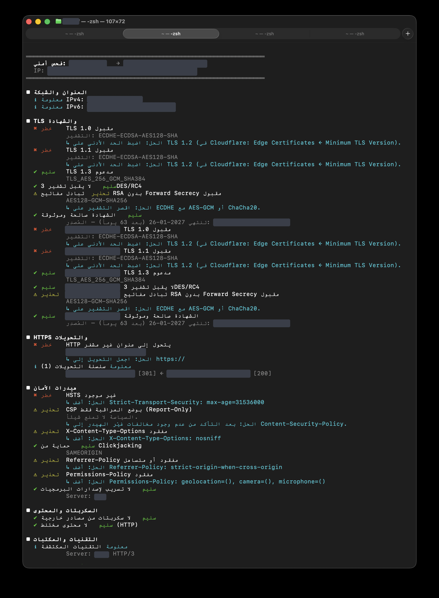
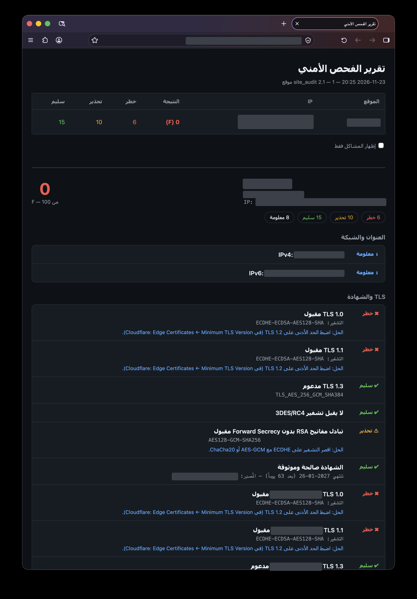
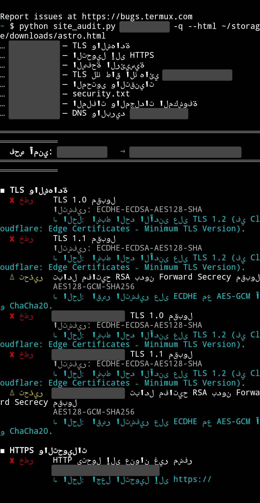

# أداة فحص أمني لمواقع الويب (site-audit)

أداة سطر أوامر تفحص أمان أي موقع ويب ونطاقه من الخارج، وتعطيك النتيجة بالعربي في الطرفية وفي تقرير HTML منسّق. ملف واحد مكتوب بلغة Python، بدون أي مكتبات خارجية، ويعمل على macOS وLinux وWindows وأندرويد (Termux).

تجمع الأداة في فحص واحد ما تفعله عادة عدة أدوات منفصلة: فحص التشفير، والهيدرات، وجدار الحماية، وسجلات البريد، والملفات المكشوفة. وتقترح لكل مشكلة طريقة إصلاحها.

> ⚠️ **استخدمها فقط على مواقع تملكها أو لديك إذن مكتوب بفحصها.** لفحص أي موقع آخر استخدم الوضع السلبي ‎`--passive` (التفاصيل في قسم [الاستخدام المسؤول](#الاستخدام-المسؤول)).

---

## لقطات من الأداة

النتيجة في طرفية macOS:



تقرير HTML في المتصفح:



التشغيل على أندرويد عبر Termux:



> أُخفيت من اللقطات بيانات الموقع الذي جرى فحصه.

---

## ماذا تفحص الأداة؟

أكثر من 80 فحصاً في 14 قسماً:

<div dir="rtl">

<table>
<thead><tr><th>القسم</th><th>ما يشمله</th></tr></thead>
<tbody>
<tr><td>العنوان والشبكة</td><td>عناوين IPv4 وIPv6، ومزوّد الشبكة (ASN) ومالكها، والدولة، والاسم العكسي (PTR)، وكشف وجود CDN</td></tr>
<tr><td>TLS والشهادة</td><td>قبول TLS 1.0 و1.1، ودعم TLS 1.3، والتشفير الضعيف (3DES وRC4)، وForward Secrecy، وصلاحية الشهادة وتاريخ انتهائها</td></tr>
<tr><td>HTTPS والتحويلات</td><td>التحويل من HTTP إلى HTTPS، ونوعه (301 أو 308)، وسلسلة التحويلات، ومرورها عبر HTTP</td></tr>
<tr><td>هيدرات الأمان</td><td>‏HSTS، وCSP، وX-Content-Type-Options، والحماية من Clickjacking، وReferrer-Policy، وPermissions-Policy، وكشف إصدارات البرمجيات</td></tr>
<tr><td>السكربتات والمحتوى</td><td>السكربتات الخارجية بدون SRI، والاستيراد الديناميكي، وeval، وملفات source map، والمحتوى المختلط، والنماذج غير المشفرة</td></tr>
<tr><td>التقنيات والمكتبات</td><td>التعرف على الخادم والـ CDN ونظام إدارة المحتوى، والمكتبات القديمة ذات الثغرات المعروفة (jQuery وBootstrap وAngularJS وLodash وMoment) مع مصدر كل اكتشاف</td></tr>
<tr><td>جدار الحماية (WAF)</td><td>التعرف على 18 نظاماً، منها Cloudflare وF5 وFortiWeb وImperva وAkamai وAWS وAzure، واختبار هل يحجب الهجمات فعلاً، وكشف عنوان الخادم الأصلي المكشوف من خلفه</td></tr>
<tr><td>WordPress</td><td>كشف أسماء المستخدمين، وxmlrpc، وسجل debug.log، وملف readme، وفهرسة مجلد uploads، والنسخ الاحتياطية من wp-config</td></tr>
<tr><td>الكوكيز و CORS</td><td>خصائص الكوكيز (Secure وHttpOnly وSameSite)، وإعدادات CORS الخطرة، وطريقة TRACE</td></tr>
<tr><td>ملفات ومجلدات مكشوفة</td><td>30 ملفاً حساساً، مثل ‎<code>.env</code> و‎<code>.git</code> ونسخ قواعد البيانات، و9 مجلدات للفهرسة، ولوحات phpMyAdmin</td></tr>
<tr><td>ملف security.txt</td><td>وجوده، وحقل Expires، وصلاحيته</td></tr>
<tr><td>DNS والبريد</td><td>‏SPF مع عدّ الاستعلامات، وDMARC، وDKIM بـ 28 محدِّداً، وMTA-STS، وTLS-RPT، وCAA، وDNSSEC، وخوادم الأسماء</td></tr>
<tr><td>المنافذ (اختياري)</td><td>27 منفذاً خطيراً، مثل Redis وMySQL وRDP وDocker وElasticsearch</td></tr>
<tr><td>النطاقات الفرعية (اختياري)</td><td>جمعها من سجلات الشهادات، وكشف سجلات CNAME المعلّقة وخطر الاستيلاء عليها</td></tr>
</tbody>
</table>

</div>

كل نتيجة تأتي بأحد أربعة تصنيفات:

<div dir="rtl">

<table>
<thead><tr><th>التصنيف</th><th>المعنى</th></tr></thead>
<tbody>
<tr><td>✖ خطر</td><td>مشكلة تحتاج إصلاحاً، وتخصم 12 نقطة</td></tr>
<tr><td>⚠ تحذير</td><td>نقطة ضعف أو إعداد ناقص، ويخصم 4 نقاط</td></tr>
<tr><td>✔ سليم</td><td>الإعداد صحيح</td></tr>
<tr><td>ℹ معلومة</td><td>معلومة للاطلاع، بدون أثر على النتيجة</td></tr>
</tbody>
</table>

</div>

في النهاية تعطيك الأداة درجة من 100 وتقديراً من A إلى F.

---

## المتطلبات

- لغة Python بالإصدار 3.8 أو أحدث، ولا شيء غيرها.
- اتصال بالإنترنت.

لا تحتاج تثبيت أي مكتبة. استعلامات DNS تتم عبر DNS-over-HTTPS، فلا تحتاج أدوات مثل `dig`.

---

## التحميل

الطريقة الأولى، تحميل الملف وحده:

```bash
curl -O https://raw.githubusercontent.com/astrom2/site-audit/main/site_audit.py
```

الطريقة الثانية، نسخ المستودع كاملاً:

```bash
git clone https://github.com/astrom2/site-audit.git
cd site-audit
```

---

## التشغيل حسب النظام

### نظام macOS

بايثون موجود غالباً. للتأكد:

```bash
python3 --version
```

التشغيل:

```bash
python3 site_audit.py example.com
```

لفحص كامل يُنصح ببايثون من Homebrew، لأن النسخة المدمجة مع الماك قد لا تسمح باختبار TLS 1.0 و1.1:

```bash
brew install python
```

لتشغيلها كأمر من أي مكان باسم `site-audit` (مرة واحدة):

```bash
mkdir -p ~/.local/bin
cp site_audit.py ~/.local/bin/site-audit
chmod +x ~/.local/bin/site-audit
xattr -d com.apple.quarantine ~/.local/bin/site-audit 2>/dev/null
echo 'export PATH="$HOME/.local/bin:$PATH"' >> ~/.zshrc
source ~/.zshrc
```

بعدها:

```bash
site-audit example.com
```

### نظام Linux

بايثون موجود في أغلب التوزيعات، مثل Ubuntu وDebian وFedora وRaspberry Pi OS:

```bash
python3 site_audit.py example.com
```

وللتثبيت كأمر، استخدم نفس خطوات الماك لكن مع ‎`~/.bashrc` بدل ‎`~/.zshrc`، وبدون سطر `xattr`.

### نظام Windows

1. ثبّت بايثون من [python.org](https://www.python.org/downloads/)، وفعّل خيار **Add python.exe to PATH** أثناء التثبيت.
2. افتح **Windows Terminal** أو PowerShell في مجلد الأداة، ثم شغّلها:

    ```powershell
    py site_audit.py example.com
    ```

للتحميل من PowerShell:

```powershell
curl.exe -O https://raw.githubusercontent.com/astrom2/site-audit/main/site_audit.py
```

طرفية Windows لا تعرض العربي من اليمين لليسار بشكل جيد، لذلك يُفضّل حفظ التقرير وفتحه في المتصفح:

```powershell
py site_audit.py example.com --html report.html --open
```

### أندرويد عبر Termux

1. ثبّت تطبيق Termux من F-Droid أو من صفحة إصداراته على GitHub.
2. ثبّت بايثون واسمح بالوصول لملفات الهاتف:

    ```bash
    pkg update && pkg install python
    termux-setup-storage
    ```

3. حمّل الأداة وشغّلها:

    ```bash
    curl -O https://raw.githubusercontent.com/astrom2/site-audit/main/site_audit.py
    python site_audit.py example.com
    ```

4. احفظ التقرير في مجلد التنزيلات وافتحه في المتصفح:

    ```bash
    python site_audit.py example.com --html ~/storage/downloads/report.html
    termux-open ~/storage/downloads/report.html
    ```

طرفية Termux تعرض الحروف العربية مقطّعة، لذلك اعتمد على تقرير HTML في القراءة. وإذا كانت الشبكة بطيئة أضف ‎`--timeout 25`.

---

## الأوامر والخيارات

الصيغة العامة:

```bash
python3 site_audit.py [OPTIONS] TARGET [TARGET ...]
```

### تحديد المواقع

<div dir="rtl">

<table>
<thead><tr><th>الخيار</th><th>الوظيفة</th></tr></thead>
<tbody>
<tr><td>الموقع مباشرة</td><td>فحص موقع واحد، مثل <code>example.com</code> أو <code>https://www.example.com</code></td></tr>
<tr><td>عدة مواقع</td><td>فحصها دفعة واحدة: <code>example.com example.org</code></td></tr>
<tr><td nowrap>الخيار ‎<code>-f FILE</code></td><td>قراءة المواقع من ملف، كل موقع في سطر، والأسطر التي تبدأ بـ ‎<code>#</code>‎ تُتجاهل</td></tr>
<tr><td nowrap>الخيار ‎<code>--domain</code></td><td>تحديد النطاق الرئيسي لفحوصات DNS يدوياً</td></tr>
</tbody>
</table>

</div>

### مستوى الفحص

<div dir="rtl">

<table>
<thead><tr><th>الخيار</th><th>الوظيفة</th></tr></thead>
<tbody>
<tr><td>بدون خيارات</td><td>الفحص العادي: TLS والهيدرات والمحتوى والـ WAF مع اختبار الحجب والملفات الحساسة وDNS</td></tr>
<tr><td nowrap>الخيار ‎<code>--passive</code></td><td>وضع سلبي: يلاحظ فقط ولا يرسل أي طلب يشبه الهجوم</td></tr>
<tr><td nowrap>الخيار ‎<code>--ports</code></td><td>يضيف فحص المنافذ الخطرة</td></tr>
<tr><td nowrap>الخيار ‎<code>--subdomains</code></td><td>يضيف فحص النطاقات الفرعية وخطر الاستيلاء عليها</td></tr>
<tr><td nowrap>الخيار ‎<code>--full</code></td><td>كل الفحوصات، بما فيها المنافذ والنطاقات الفرعية</td></tr>
<tr><td nowrap>الخيار ‎<code>--skip-dns</code></td><td>يتخطى فحوصات DNS والبريد، وهذا أسرع</td></tr>
</tbody>
</table>

</div>

### المخرجات

<div dir="rtl">

<table>
<thead><tr><th>الخيار</th><th>الوظيفة</th></tr></thead>
<tbody>
<tr><td nowrap>الخيار ‎<code>--html FILE</code></td><td>حفظ تقرير HTML</td></tr>
<tr><td nowrap>الخيار ‎<code>--open</code></td><td>فتح تقرير HTML في المتصفح تلقائياً</td></tr>
<tr><td nowrap>الخيار ‎<code>--json FILE</code></td><td>حفظ النتائج بصيغة JSON</td></tr>
<tr><td nowrap>الخيار ‎<code>-q</code></td><td>عرض المشاكل فقط في الطرفية</td></tr>
<tr><td nowrap>الخيار ‎<code>--no-color</code></td><td>إلغاء الألوان</td></tr>
<tr><td nowrap>الخيار ‎<code>--timeout N</code></td><td>مهلة كل اتصال بالثواني، والافتراضي 10</td></tr>
<tr><td nowrap>الخيار ‎<code>-h</code></td><td>عرض المساعدة</td></tr>
</tbody>
</table>

</div>

### أمثلة

فحص عادي:

```bash
python3 site_audit.py example.com
```

عرض المشاكل فقط:

```bash
python3 site_audit.py example.com -q
```

فحص شامل مع حفظ التقرير وفتحه:

```bash
python3 site_audit.py example.com --full --html report.html --open
```

فحص سلبي آمن لموقع لا تملكه:

```bash
python3 site_audit.py www.example.org --passive --html report.html
```

فحص عدة مواقع وحفظ النتائج بصيغتين:

```bash
python3 site_audit.py example.com example.org --html sites.html --json sites.json
```

فحص قائمة مواقع من ملف:

```bash
printf "example.com\nexample.org\n# skipped line\n" > sites.txt
python3 site_audit.py -f sites.txt --html sites.html
```

فحص سريع بدون DNS والبريد:

```bash
python3 site_audit.py example.com --skip-dns
```

إذا كان النطاق بدون موقع ويُستخدم للبريد فقط، تكمل الأداة فحوصات DNS والبريد وتعرض ذلك كمعلومة وليس كخطأ.

---

## حفظ التقرير بصيغة HTML

أضف الخيار ‎`--html` مع اسم الملف:

```bash
python3 site_audit.py example.com --html report.html
```

في آخر المخرجات تطبع الأداة المسار الكامل للملف بعد عبارة **تقرير HTML:**. لفتحه:

<div dir="rtl">

<table>
<thead><tr><th>النظام</th><th>الأمر</th></tr></thead>
<tbody>
<tr><td>ماك</td><td nowrap><code>open report.html</code></td></tr>
<tr><td>لينكس</td><td nowrap><code>xdg-open report.html</code></td></tr>
<tr><td>ويندوز</td><td nowrap><code>start report.html</code></td></tr>
<tr><td>تيرمكس</td><td nowrap><code>termux-open report.html</code></td></tr>
<tr><td>الكل</td><td nowrap>أضف ‎<code>--open</code> لفتحه تلقائياً</td></tr>
</tbody>
</table>

</div>

ما يحتويه التقرير:

- جدول ملخص بكل المواقع المفحوصة، مع عناوين IP والدرجة وعدد المشاكل.
- قسم لكل موقع، فيه كل الفحوصات مرتبة حسب الفئة، مع طريقة الإصلاح لكل مشكلة.
- خيار **إظهار المشاكل فقط** لإخفاء النتائج السليمة.
- تصميم عربي من اليمين لليسار، يعمل بدون إنترنت، ويمكن إرساله أو طباعته.

تنبيه: لا تكتب أمر الفتح بعد ‎`&&`‎، لأن الأداة تنتهي برمز 1 إذا وجدت مشكلة خطيرة، فلن يُنفَّذ الأمر الثاني. استخدم ‎`;`‎ أو الخيار ‎`--open`.

```bash
python3 site_audit.py example.com --html report.html ; open report.html
```

---

## الاستخدام المسؤول

<div dir="rtl">

<table>
<thead><tr><th>الوضع</th><th>ما يفعله</th><th>متى تستخدمه</th></tr></thead>
<tbody>
<tr><td nowrap>الوضع السلبي ‎<code>--passive</code></td><td>يقرأ ما يراه أي زائر عادي: الشهادة والهيدرات والصفحة الرئيسية وDNS</td><td>أي موقع لا تملكه</td></tr>
<tr><td>الوضع العادي</td><td>يضيف اختبارات حجب الـ WAF والبحث عن الملفات الحساسة</td><td>موقعك، أو موقع لديك إذن مكتوب بفحصه</td></tr>
<tr><td nowrap>الخيار ‎<code>--ports</code> أو ‎<code>--full</code></td><td>يضيف فحص المنافذ</td><td>موقعك وخوادمك فقط</td></tr>
</tbody>
</table>

</div>

الوضع العادي يرسل طلبات تشبه الهجوم، مثل ‎`<script>`‎ و‎`' OR 1=1`، ويطلب مسارات حساسة مثل ‎`/.env`. أنظمة الحماية قد تسجّل ذلك كمحاولة اختراق وتحظر عنوانك. والفحص بدون إذن قد يخالف القانون في بلدك.

---

## الرقم الذي تُرجعه الأداة عند انتهائها (للسكربتات والجدولة)

عند انتهاء الفحص تُرجع الأداة رقماً يقرؤه نظام التشغيل، وتستطيع السكربتات أو المهام المجدولة الاعتماد عليه لمعرفة النتيجة بدون قراءة التقرير:

<div dir="rtl">

<table>
<thead><tr><th>الرقم</th><th>المعنى</th></tr></thead>
<tbody>
<tr><td>‏0</td><td>لا توجد مشاكل خطيرة</td></tr>
<tr><td>‏1</td><td>وُجدت مشكلة واحدة على الأقل مصنفة <strong>خطر</strong></td></tr>
<tr><td>‏2</td><td>خطأ في كتابة الأمر، مثل خيار غير معروف أو عدم تحديد موقع</td></tr>
</tbody>
</table>

</div>

هذا مفيد عند جدولة الفحص تلقائياً، مثلاً عبر cron، ليرسل لك تنبيهاً عند ظهور مشكلة.

---

## حدود الأداة

- الفحص خارجي ولحظي، ولا يرى ما خلف تسجيل الدخول ولا منطق التطبيق، فهو ليس بديلاً عن اختبار اختراق كامل.
- كشف إصدارات المكتبات يعتمد على أسماء الملفات وتعليقاتها، فتحقّق من المصدر المذكور مع كل نتيجة.
- اختبار TLS 1.0 و1.1 يعتمد على نسخة OpenSSL في جهازك، وقد تظهر عبارة **تعذّر الاختبار**.
- بعض الفحوصات تعتمد على خدمات عامة: DNS-over-HTTPS من Cloudflare وGoogle، وسجلات الشهادات من crt.sh، ومعلومات الشبكات من Team Cymru.
